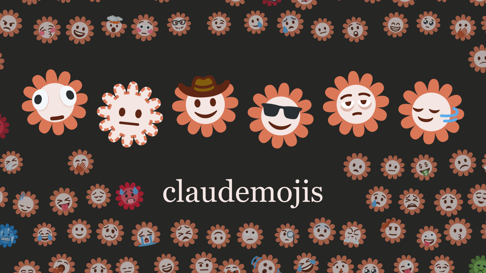

# claudemojis

Flower-Claude versions of the [Twemoji](https://github.com/jdecked/twemoji) face emoji.



## What's here

| Path | What it is |
|---|---|
| `flowerize.py` | Generates flower faces from twemoji SVGs (Python 3, no dependencies) |
| `make_site.py` | Builds `index.html` (from `site_template.html`), the searchable gallery served by GitHub Pages |
| `out/png/`, `custom/png/` | 256×256 PNG renders, named `claude-<name>.png` (SVGs use the same `claude-<name>.svg` names) |
| `make_preview.py` | Builds `preview.html`, a page comparing every face with its original |
| `New Project(1).svg` | The flower shape |
| `custom/` | Hand-edited finished faces; these take priority over generated ones |
| `out/svg/` | Generated faces |
| `new/`, `new/png/` | Original faces with no Unicode equivalent, as SVG and 256×256 PNG |
| `data/emoji-test.txt` | Unicode's emoji list (17.0), used to pick out the face emoji |

## Regenerating

```sh
git clone --depth 1 https://github.com/jdecked/twemoji.git twemoji-jdecked
python flowerize.py        # writes out/svg/
python make_preview.py     # writes preview.html (uses custom/ first)
```

Useful options: `--content-scale` (feature size, default 0.65), `--flower-scale`, `--feature-colour`, `--shadow-mix`, `--wash-colour`, `--only <codepoints>`. Run `python flowerize.py --help` for all of them.

## Credits and licence

- Emoji artwork is derived from **Twemoji** by Twitter, Inc. and other contributors, maintained at [jdecked/twemoji](https://github.com/jdecked/twemoji). The graphics are licensed under [CC-BY 4.0](https://creativecommons.org/licenses/by/4.0/); the derived SVGs here are shared under the same licence, and have been modified from the originals.
- `data/emoji-test.txt` is © Unicode, Inc., distributed under the [Unicode License](https://www.unicode.org/license.txt).
